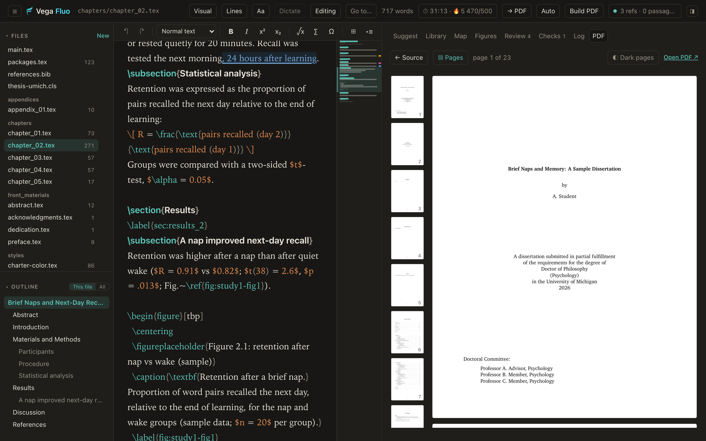
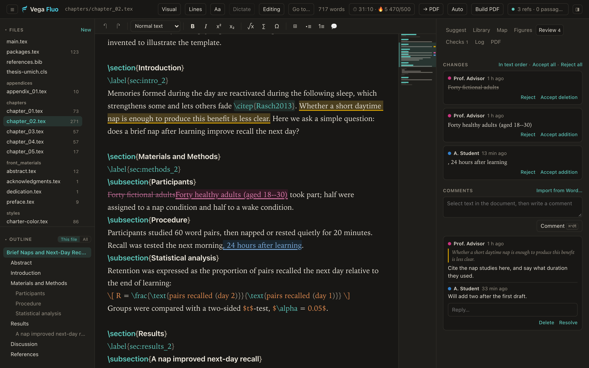
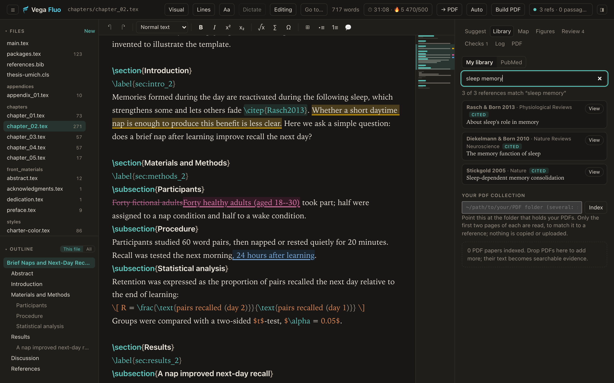
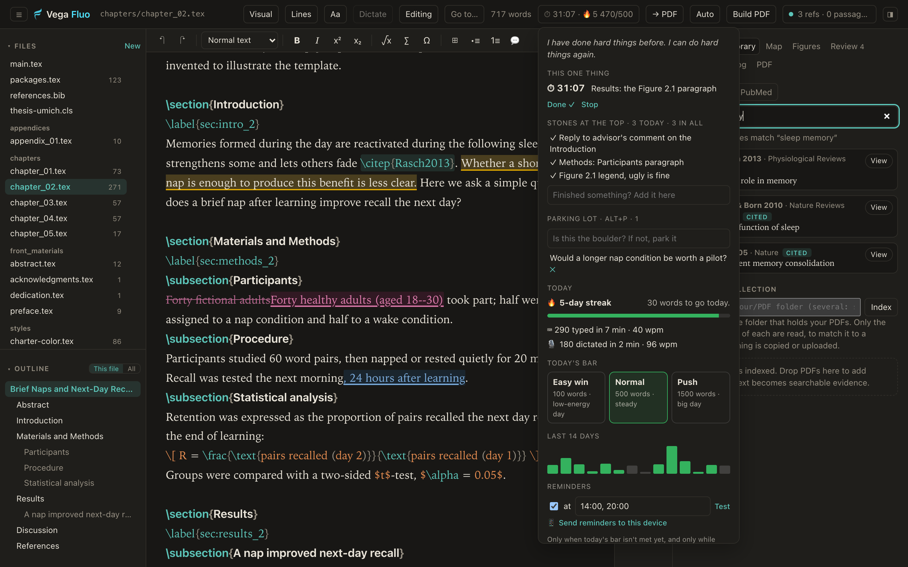
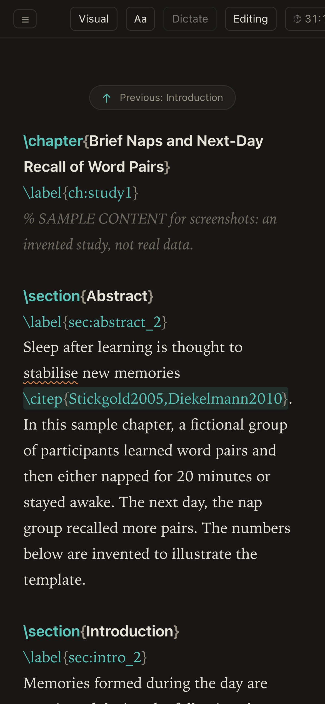

# Vega Fluo — a thesis starter

A local writing environment for a LaTeX dissertation, with a blank University of Michigan (Rackham)
thesis to start from.

- **Write** LaTeX, or switch to a visual view that hides most of it; the PDF builds locally (Tectonic).
- **Review**: your advisor reviews a live Google Doc with readable math and figure numbers; their
  suggestions and comments come back as tracked changes on your source.
- **Cite**: full-text search of your own PDF library suggests citations for the paragraph you're writing.
- **Dictate**: Whisper on your own computer, with voice commands ("new section Results…") and
  spoken citations ("Smith et al. 2019") turned into `\citep{…}`.
- **Keep going**: a daily bar you can set low on hard days, a streak, a 45-minute Finish Game, a log
  of finished things, a parking lot for tangents, and reminders.

| | |
|---|---|
|  |  |
| **Review.** An advisor's suggestions and comments arrive as tracked changes on your LaTeX. | **Library.** Your references, searchable beside the text; cited ones are marked. |
|  |  |
| **Keep going.** Today's bar, a streak, the 45-minute Finish Game, finished things, a parking lot. | **Phone.** The same editor as a Home Screen app. |

*Screenshots show a demo project with invented content.*

**Start here:** [`starter/README.md`](starter/README.md) — about 15 minutes from install to a building thesis.
How it compares with Word, Pages and Overleaf: [`docs/COMPARISON.md`](docs/COMPARISON.md).

## Not included
- `thesis-umich.cls`, the Rackham class file: it carries no license statement, so get it from the
  U-M Dissertation LaTeX Template (see the starter README).
- Recorded keyboard-sound packs: the originals are GPL-3.0. The editor's built-in sounds still work.

## License
MIT — see [LICENSE](LICENSE).
